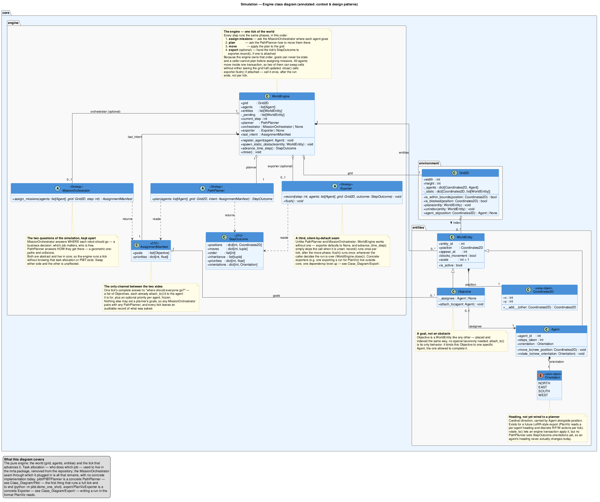

# MAPF Simulation

A small **Multi-Agent Path Finding (MAPF)** simulator with a pluggable coordinator
interface, with no algorithm plugged in right now.

> **Currently just the abstractions, nothing runnable.** `core/` declares `PathPlanner`
> and `MissionOrchestrator`, but nothing implements either anymore — `algo/` (PIBT, LaCAM, PIBT+,
> random walk, the allocators), `mrta/` (task allocation) and `client/`/`report/` (scenario
> wiring, run measurement) were all removed on purpose, one after the other. See
> [`TODO.md`](TODO.md): nothing in the repo runs end to end today, including every
> `sim_many_*.py` sweep.



## Inspiration & attribution

Until it was removed (see [`TODO.md`](TODO.md)), this project's PIBT coordinator was an
**independent reimplementation** inspired by the work of **Okumura et al.**:

> Keisuke Okumura, Manao Machida, Xavier Défago, Yasumasa Tamura.
> *"Priority Inheritance with Backtracking for Iterative Multi-Agent Path Finding."*
> Artificial Intelligence, 2022 (originally IJCAI 2019).
> [arXiv:1901.11282](https://arxiv.org/abs/1901.11282)

This repository is a learning/demo project and is **not** affiliated with the
original authors.

## Features

- **Pure simulation core** (`core/`) with zero rendering dependency.
- **Pluggable `PathPlanner` interface** — drop in any MAPF algorithm; every `plan()`
  returns a uniform `StepOutcome` DTO. No concrete one is provided currently.
- Deferred spawns and impassable obstacles.

## Requirements

- Python 3.10+ (developed on 3.14)
- No runtime dependencies (`requirements.txt` is currently empty)

## Installation

```bash
# (optional) create a virtual environment
python -m venv .venv
source .venv/bin/activate        # Windows: .venv\Scripts\activate
```

## Running it

Nothing runs end to end right now — see [`TODO.md`](TODO.md) for the full picture. `core/`
still imports cleanly and can be exercised directly (construct a `Grid2D`/`Agent` by hand),
there is just no `PathPlanner` implementation to run a full tick with.

## Project structure

```
core/       pure simulation engine — entities/ (Coordinates2D, WorldEntity, Orientation,
            Agent, Objective), environment/ (Grid2D), engine/ (WorldEngine, PathPlanner,
            MissionOrchestrator, StepOutcome, AssignmentManifest)
diagrammes/ PlantUML class diagram sources + generated PNGs
main.py     CLI entry point — BROKEN, see TODO.md
```

`core/` has no dependents in the repository right now, and no outgoing dependencies of its
own. See [`GUIDE.md`](GUIDE.md) for a human tour of the project and [`AGENT.md`](AGENT.md)
for the full architecture reference.

## Adding your own algorithm

Subclass `PathPlanner` and implement `plan()`, returning a `StepOutcome`. Goals and
priorities arrive through the tick's `AssignmentManifest`, as a list of `Objective`s each
already bound to the one `Agent` allowed to complete it:

```python
from core import PathPlanner, StepOutcome

class MyAlgo(PathPlanner):
    def plan(self, agents, grid, intent) -> StepOutcome:
        goal_by_agent = {o.assignee.agent_id: o.position for o in intent.goals if o.assignee}
        positions = {a.agent_id: goal_by_agent.get(a.agent_id, a.position) for a in agents}
        moves = {a.agent_id: (a.position, positions[a.agent_id]) for a in agents}
        return StepOutcome(positions=positions, moves=moves)
```

Wire it in with `WorldEngine(grid, planner=MyAlgo())`. Without a `MissionOrchestrator`
attached, `intent` is an empty `AssignmentManifest()` every tick (`intent.goals == []`), so
`MyAlgo` above would just leave every agent where it stands — there is currently no concrete
`MissionOrchestrator` in the repo to supply goals. There is also no reference `PathPlanner`
implementation left to copy the shape of — see [`TODO.md`](TODO.md).

## License

[MIT](LICENSE) © 2026 Arcko5
